<p align="center">
  
</p>

<p align="center">
  
  
  
  
  
</p>

<p align="center">
  <a href="#-installation">Installation</a> ·
  <a href="#-modèle-de-données">Modèle de données</a> ·
  <a href="#-endpoints">Endpoints</a> ·
  <a href="#-erreurs">Erreurs</a> ·
  <a href="#-tests">Tests</a>
</p>

---

## ✨ Présentation

**Voyages Scolaires** est une API REST construite avec Laravel 13 pour organiser les sorties et voyages d'un établissement :

- 🧭 **Voyages** : destination, dates, prix, participation des familles, nombre de places, transport ;
- 🏫 **Classes** concernées par chaque voyage ;
- 📄 **Pièces administratives** à fournir (autorisation de sortie, carte d'identité…).

Toutes les réponses sont en **JSON** et tous les messages d'erreur sont en **français**.

## 🚀 Installation

> **Prérequis :** PHP 8.3+, Composer et Node.js.

```bash
git clone https://github.com/AxelAllProject/voyagescolaire.git
cd voyagescolaire

composer install
cp .env.example .env
php artisan key:generate

touch database/database.sqlite
php artisan migrate

php artisan serve
```

L'API est alors disponible sur **`http://127.0.0.1:8000/api`**.

## 🗂️ Modèle de données

```mermaid
erDiagram
    VOYAGES ||--o{ CLASSE_VOYAGE : "concerne"
    CLASSES ||--o{ CLASSE_VOYAGE : "participe"
    VOYAGES ||--o{ PIECE_ADMINISTRATIVE_VOYAGE : "exige"
    PIECES_ADMINISTRATIVES ||--o{ PIECE_ADMINISTRATIVE_VOYAGE : "requise pour"

    VOYAGES {
        bigint id PK
        string titre
        text description
        string image "nullable"
        string destination
        date date_debut
        date date_fin
        decimal prix
        decimal participation_familiale
        int nb_places
        string transport
    }
    CLASSES {
        bigint id PK
        string nom
    }
    PIECES_ADMINISTRATIVES {
        bigint id PK
        string nom
        text description "nullable"
    }
    CLASSE_VOYAGE {
        bigint classe_id FK
        bigint voyage_id FK
    }
    PIECE_ADMINISTRATIVE_VOYAGE {
        bigint piece_administrative_id FK
        bigint voyage_id FK
    }
```



## 📡 Endpoints

Toutes les routes sont préfixées par `/api`. Envoyez l'en-tête `Accept: application/json`. Les dates sont au format `AAAA-MM-JJ`.

### Voyages

| Méthode  | URL                 | Action                                  | Succès |
|----------|---------------------|-----------------------------------------|:------:|
| `GET`    | `/api/voyages`      | Lister les voyages                      | `200`  |
| `POST`   | `/api/voyages`      | Créer un voyage                         | `201`  |
| `GET`    | `/api/voyages/{id}` | Afficher un voyage                      | `200`  |
| `PUT`    | `/api/voyages/{id}` | Remplacer un voyage (tous les champs)   | `200`  |
| `PATCH`  | `/api/voyages/{id}` | Modifier uniquement les champs envoyés  | `200`  |
| `DELETE` | `/api/voyages/{id}` | Supprimer un voyage                     | `204`  |

<details>
<summary><strong>Champs et règles de validation</strong></summary>

| Champ                     | Type   | Règles                                       |
|---------------------------|--------|----------------------------------------------|
| `titre`                   | texte  | obligatoire, 255 caractères max              |
| `description`             | texte  | obligatoire                                  |
| `image`                   | texte  | facultatif, 255 caractères max               |
| `destination`             | texte  | obligatoire, 255 caractères max              |
| `date_debut`              | date   | obligatoire                                  |
| `date_fin`                | date   | obligatoire, postérieure ou égale à `date_debut` |
| `prix`                    | nombre | obligatoire, ≥ 0                             |
| `participation_familiale` | nombre | obligatoire, ≥ 0                             |
| `nb_places`               | entier | obligatoire, ≥ 1                             |
| `transport`               | texte  | obligatoire, 255 caractères max              |

Avec `PATCH`, seuls les champs envoyés sont validés et modifiés. Avec `PUT`, tous les champs obligatoires doivent être envoyés.

</details>

### Exemple : créer un voyage

```bash
curl -X POST http://127.0.0.1:8000/api/voyages \
  -H "Accept: application/json" \
  -H "Content-Type: application/json" \
  -d '{
    "titre": "Découverte de Rome",
    "description": "Visite du Colisée et du Vatican.",
    "destination": "Rome",
    "date_debut": "2027-03-01",
    "date_fin": "2027-03-05",
    "prix": 520.50,
    "participation_familiale": 200,
    "nb_places": 35,
    "transport": "car"
  }'
```

<details>
<summary>Réponse <code>201 Created</code></summary>

```json
{
  "id": 1,
  "titre": "Découverte de Rome",
  "description": "Visite du Colisée et du Vatican.",
  "image": null,
  "destination": "Rome",
  "date_debut": "2027-03-01T00:00:00.000000Z",
  "date_fin": "2027-03-05T00:00:00.000000Z",
  "prix": "520.50",
  "participation_familiale": "200.00",
  "nb_places": 35,
  "transport": "car",
  "created_at": "2026-10-19T10:00:00.000000Z",
  "updated_at": "2026-10-19T10:00:00.000000Z"
}
```

</details>

## ⚠️ Erreurs

| Code  | Cas                            | Réponse                                         |
|:-----:|--------------------------------|-------------------------------------------------|
| `404` | Voyage ou route inexistant     | `{"message": "Ressource introuvable."}`          |
| `405` | Méthode HTTP non autorisée     | `{"message": "Méthode non autorisée"}`           |
| `422` | Données invalides              | `message` + détail par champ dans `errors`       |

Exemple de réponse `422 Unprocessable Content` :

```json
{
  "message": "Le champ description est obligatoire. (et 6 erreurs en plus)",
  "errors": {
    "description": ["Le champ description est obligatoire."],
    "date_fin": ["Le champ date de fin doit être une date postérieure ou égale au date de début."],
    "nb_places": ["Le champ nombre de places est obligatoire."]
  }
}
```

> Les traductions se trouvent dans `lang/fr` (paquet `laravel-lang`). Les noms de champs affichés dans les messages (`date de début`, `nombre de places`…) sont définis dans `lang/fr/validation.php`, section `attributes`.

## 🧪 Tests

```bash
php artisan test
```

Les tests de l'API (`tests/Feature/VoyageApiTest.php`) couvrent la liste, l'affichage, la création, `PUT`, `PATCH`, la suppression, les erreurs 404 et 405, et les messages de validation en français.

## 📁 Structure du projet

```
app/
├── Http/Controllers/VoyageController.php   # CRUD des voyages
└── Models/                                 # Voyage, Classe, PieceAdministrative
bootstrap/app.php                           # Réponses JSON 404 / 405 en français
database/
├── factories/VoyageFactory.php
└── migrations/                             # Tables + tables pivot
lang/fr/                                    # Traductions françaises
routes/api.php                              # Route::apiResource('voyages', …)
tests/Feature/VoyageApiTest.php
```

---

<p align="center">
  <br>
  <sub>Voyages Scolaires · construit avec Laravel</sub>
</p>
