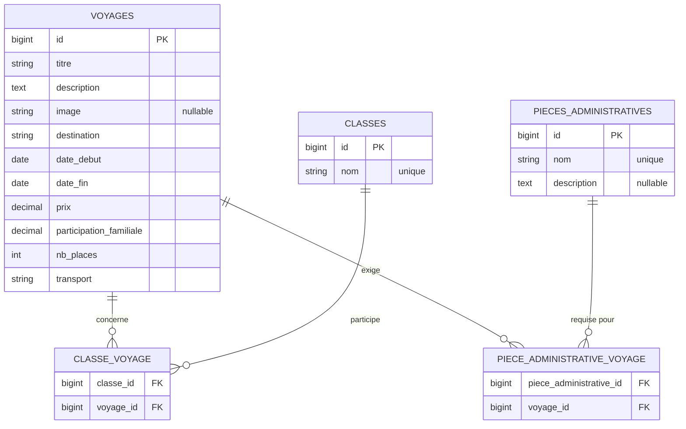

<p align="center">
  
</p>

<p align="center">
  
  
  
  
  
</p>

<p align="center">
  <a href="#-installation">Installation</a> ·
  <a href="#-le-site">Le site</a> ·
  <a href="#-modèle-de-données">Modèle de données</a> ·
  <a href="#-api">API</a> ·
  <a href="#-tests">Tests</a>
</p>

---

## ✨ Présentation

**Voyages Scolaires** est une application Laravel 13 pour organiser les sorties et voyages d'un établissement :

- 🧭 **Voyages** : destination, dates, budget, participation des familles, nombre de places, transport ;
- 🏫 **Classes** qui partent en voyage ;
- 📄 **Pièces administratives** à fournir par les familles (autorisation parentale, fiche sanitaire…).

Elle propose un **site web** (Blade + Bootstrap 5) et une **API REST** JSON. Tous les textes et messages d'erreur sont en **français**.

## 🚀 Installation

> **Prérequis :** PHP 8.3+, Composer et Node.js.

```bash
git clone https://github.com/AxelAllProject/voyagescolaire.git
cd voyagescolaire

composer install
cp .env.example .env
php artisan key:generate

touch database/database.sqlite
php artisan migrate --seed   # crée les tables et des données de démonstration

npm install
npm run build

php artisan serve
```

Le site est alors disponible sur **http://127.0.0.1:8000** et l'API sur **http://127.0.0.1:8000/api**.

Le seeder ajoute 8 classes (de la 6e A à la 3e B), 6 pièces administratives courantes, 4 voyages (Rome, Londres, Chamonix et une sortie passée au Futuroscope) et deux comptes de démonstration :

| Email                   | Mot de passe | Rôle           |
|-------------------------|--------------|----------------|
| `admin@example.com`     | `password`   | Administrateur |
| `personnel@example.com` | `password`   | Personnel      |

> ⚠️ Ces comptes servent uniquement au développement. En production, créez les vrais comptes avec `php artisan utilisateur:creer`.

## 🔐 Comptes et droits

Il n'y a pas d'inscription publique : un administrateur crée les comptes du personnel en ligne de commande.

```bash
php artisan utilisateur:creer                       # questions interactives
php artisan utilisateur:creer --nom="Mme Martin" --email=martin@college.fr --role=personnel
```

| Action                                         | Visiteur | Personnel | Administrateur |
|------------------------------------------------|:--------:|:---------:|:--------------:|
| Accueil, catalogue et fiches des voyages       | ✅       | ✅        | ✅             |
| Créer et modifier un voyage                    | ❌       | ✅        | ✅             |
| Supprimer un voyage                            | ❌       | ❌        | ✅             |
| Consulter les classes et les pièces            | ❌       | ✅        | ✅             |
| Ajouter, modifier, supprimer classes et pièces | ❌       | ❌        | ✅             |

La connexion se fait sur `/login` (lien « Espace personnel »). Elle est gérée par [Laravel Fortify](https://laravel.com/docs/fortify) et limitée à 5 tentatives par minute. Chacun peut changer son mot de passe dans **Mon compte**. Les droits sont définis dans `app/Policies/`.

## 🖥️ Le site

| Page                    | URL                                   | Contenu                                                                 |
|-------------------------|---------------------------------------|-------------------------------------------------------------------------|
| Accueil                 | `/`                                   | Chiffres clés, prochains voyages, étapes pour préparer un voyage, aperçu de l'API |
| Catalogue des voyages   | `/voyages`                            | Voyages à venir, passés ou tous, recherche par titre ou destination, pagination |
| Fiche d'un voyage       | `/voyages/{id}`                       | Programme, dates, durée, budget (part famille / part établissement), classes et pièces demandées |
| Nouveau voyage          | `/voyages/create`                     | Formulaire en 4 étapes avec aperçu en direct, calcul de la durée et du budget |
| Modifier un voyage      | `/voyages/{id}/edit`                  | Même formulaire, prérempli                                              |
| Classes                 | `/classes`                            | Liste, ajout, renommage et suppression des classes                      |
| Pièces administratives  | `/pieces-administratives`             | Liste, ajout, modification et suppression des pièces                    |

Les suppressions demandent une confirmation. En cas d'erreur de validation, le formulaire affiche les messages en français et conserve la saisie.

**Ordre logique :** on enregistre d'abord les classes et les pièces administratives, puis on crée le voyage en cochant celles qui le concernent.

## 🗂️ Modèle de données



Supprimer un voyage, une classe ou une pièce supprime aussi ses liaisons dans les tables pivot.

## 📡 API

Toutes les routes sont préfixées par `/api` (noms `api.voyages.*`). Envoyez l'en-tête `Accept: application/json`. Les dates sont au format `AAAA-MM-JJ`.

La lecture est publique. **L'écriture demande un jeton** ([Laravel Sanctum](https://laravel.com/docs/sanctum)), envoyé dans l'en-tête `Authorization: Bearer <jeton>`. Le jeton a les mêmes droits que le compte qui l'a créé.

```bash
# Obtenir un jeton (limité à 5 essais par minute)
curl -X POST http://127.0.0.1:8000/api/jetons \
  -H "Accept: application/json" -H "Content-Type: application/json" \
  -d '{"email": "admin@example.com", "password": "password", "appareil": "Script d'\''import"}'
# → 201 { "jeton": "1|AbC…", "utilisateur": { … } }
```

| Méthode  | URL                   | Action                                        | Jeton | Succès |
|----------|-----------------------|-----------------------------------------------|:-----:|:------:|
| `POST`   | `/api/jetons`         | Obtenir un jeton (email, mot de passe, appareil) | –  | `201`  |
| `DELETE` | `/api/jetons/actuel`  | Révoquer le jeton utilisé                     | ✅    | `204`  |
| `GET`    | `/api/voyages`        | Lister les voyages (par date de départ)       | –     | `200`  |
| `GET`    | `/api/voyages/{id}`   | Afficher un voyage avec ses classes et pièces | –     | `200`  |
| `POST`   | `/api/voyages`        | Créer un voyage                               | ✅    | `201`  |
| `PUT`    | `/api/voyages/{id}`   | Remplacer un voyage (tous les champs)         | ✅    | `200`  |
| `PATCH`  | `/api/voyages/{id}`   | Modifier uniquement les champs envoyés        | ✅    | `200`  |
| `DELETE` | `/api/voyages/{id}`   | Supprimer un voyage (administrateur)          | ✅    | `204`  |

<details>
<summary><strong>Champs et règles de validation</strong></summary>

| Champ                      | Type              | Règles                                              |
|----------------------------|-------------------|-----------------------------------------------------|
| `titre`                    | texte             | obligatoire, 255 caractères max                     |
| `description`              | texte             | obligatoire                                         |
| `image`                    | texte (URL)       | facultatif, 255 caractères max                      |
| `destination`              | texte             | obligatoire, 255 caractères max                     |
| `date_debut`               | date              | obligatoire                                         |
| `date_fin`                 | date              | obligatoire, postérieure ou égale à `date_debut`    |
| `prix`                     | nombre            | obligatoire, ≥ 0                                    |
| `participation_familiale`  | nombre            | obligatoire, ≥ 0 et ≤ `prix`                        |
| `nb_places`                | entier            | obligatoire, ≥ 1                                    |
| `transport`                | texte             | obligatoire, 255 caractères max                     |
| `classes`                  | tableau d'id      | facultatif, classes existantes                      |
| `pieces_administratives`   | tableau d'id      | facultatif, pièces existantes                       |

Avec `PATCH`, seuls les champs envoyés sont validés et modifiés ; une participation envoyée seule est comparée au prix déjà enregistré. Envoyer `classes` ou `pieces_administratives` remplace toute la liste correspondante.

La même validation (`App\Http\Requests\VoyageRequest`) sert au site et à l'API.

</details>

### Exemple : créer un voyage

```bash
curl -X POST http://127.0.0.1:8000/api/voyages \
  -H "Authorization: Bearer 1|AbC…" \
  -H "Accept: application/json" \
  -H "Content-Type: application/json" \
  -d '{
    "titre": "Découverte de Rome",
    "description": "Visite du Colisée et du Vatican.",
    "destination": "Rome, Italie",
    "date_debut": "2027-03-01",
    "date_fin": "2027-03-05",
    "prix": 520,
    "participation_familiale": 320,
    "nb_places": 48,
    "transport": "Autocar Grand Tourisme",
    "classes": [7, 8],
    "pieces_administratives": [1, 2]
  }'
```

La réponse `201 Created` contient le voyage avec ses tableaux `classes` et `pieces_administratives`.

### Erreurs

| Code  | Cas                            | Réponse                                         |
|:-----:|--------------------------------|-------------------------------------------------|
| `401` | Jeton absent ou invalide       | `{"message": "Non authentifié. Envoyez un jeton valide…"}` |
| `403` | Droits insuffisants            | `{"message": "Cette action n'est pas autorisée."}` |
| `404` | Voyage ou route inexistant     | `{"message": "Ressource introuvable."}`          |
| `405` | Méthode HTTP non autorisée     | `{"message": "Méthode non autorisée"}`           |
| `422` | Données invalides              | `message` + détail par champ dans `errors`       |

```json
{
  "message": "Le titre du voyage est obligatoire. (et 8 erreurs en plus)",
  "errors": {
    "titre": ["Le titre du voyage est obligatoire."],
    "date_fin": ["La date de retour est obligatoire."],
    "participation_familiale": ["La participation familiale est obligatoire."]
  }
}
```

## 🧪 Tests

```bash
php artisan test
```

| Fichier                                  | Ce qui est testé                                                       |
|------------------------------------------|------------------------------------------------------------------------|
| `tests/Feature/AccueilTest.php`          | Page d'accueil et prochains voyages                                    |
| `tests/Feature/VoyageWebTest.php`        | Catalogue (filtres, recherche), fiche, modification, suppression       |
| `tests/Feature/VoyageCreateTest.php`     | Formulaire de création, message flash, erreurs et saisie conservée     |
| `tests/Feature/ClasseTest.php`           | Ajout, unicité, renommage, suppression des classes                     |
| `tests/Feature/PieceAdministrativeTest.php` | Ajout, validation, modification, suppression des pièces             |
| `tests/Feature/VoyageApiTest.php`        | Toutes les routes de l'API, erreurs 404/405/422 en français            |
| `tests/Feature/AutorisationTest.php`     | Connexion, déconnexion, mot de passe, droits visiteur / personnel / admin |
| `tests/Feature/ApiAuthentificationTest.php` | Jetons Sanctum : obtention, révocation, accès refusés (401/403)     |

### Intégration continue

À chaque pull request et à chaque push sur `main`, GitHub Actions (`.github/workflows/tests.yml`) lance :

- **Tests PHP** : style du code (`pint --test`) et `php artisan test` ;
- **Build des assets** : `npm ci` puis `npm run build` ;
- **Audit de sécurité** : `composer audit` sur les dépendances.

`main` est protégée : on passe par une pull request, et les tests et le build doivent réussir avant le merge.

## 📁 Structure du projet

```
app/
├── Console/Commands/CreerUtilisateur.php     # php artisan utilisateur:creer
├── Enums/Role.php                            # admin, personnel
├── Policies/                                 # Droits sur les voyages, classes et pièces
├── Http/
│   ├── Controllers/
│   │   ├── Api/JetonController.php           # Jetons Sanctum
│   │   ├── Api/VoyageController.php          # API JSON
│   │   ├── VoyageController.php              # Pages des voyages
│   │   ├── ClasseController.php
│   │   └── PieceAdministrativeController.php
│   └── Requests/VoyageRequest.php            # Validation commune site + API
└── Models/                                   # Voyage, Classe, PieceAdministrative
bootstrap/app.php                             # Réponses JSON 404 / 405 en français
database/seeders/                             # Classes, pièces et voyages de démonstration
lang/fr/                                      # Traductions françaises
resources/
├── css/site.css, js/site.js                  # Bootstrap 5 + styles du site (Vite)
└── views/
    ├── accueil.blade.php
    ├── voyages/                              # index, show, create, edit, _form
    ├── classes/                              # index, edit
    ├── pieces-administratives/               # index, edit
    └── components/                           # layout, en-têtes, cartes, logo et illustrations SVG
routes/
├── web.php                                   # Pages du site
└── api.php                                   # Route::apiResource('voyages', …)
```

---

<p align="center">
  <br>
  <sub>Voyages Scolaires · construit avec Laravel et Bootstrap</sub>
</p>
